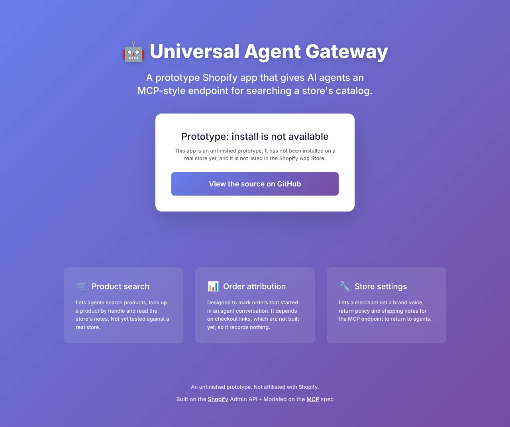
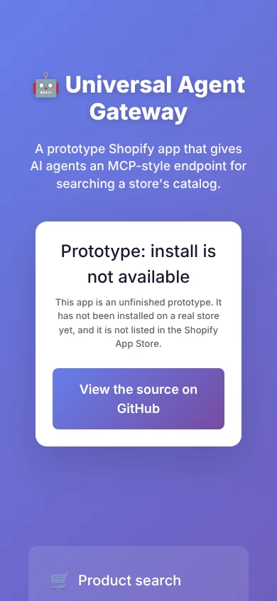
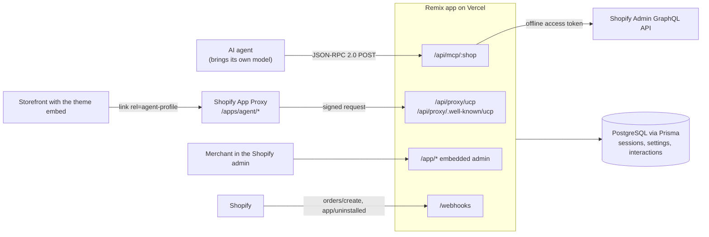

# Universal Agent Gateway

A prototype Shopify embedded app that gives AI agents an MCP-style JSON-RPC endpoint for searching a store's catalog and reading its policies.

[](https://github.com/tahmidbintaslim/shopify-ucp/actions/workflows/ci.yml)
[](LICENSE)


**Status: prototype, not production-ready.** The app has not been installed on a real store yet, the MCP endpoint has no authentication, and checkout links are not built. See [Status and roadmap](#status-and-roadmap).

**Deployed landing page:** [universal-agent-gateway.vercel.app](https://universal-agent-gateway.vercel.app). No store has the app installed there, so the deployment shows the landing page only.

<p>
  
  
</p>

## Features

What the code does today:

- **MCP-style endpoint** (`/api/mcp/:shop`): JSON-RPC 2.0 over plain HTTP POST, modeled on MCP protocol version `2024-11-05`. It implements `initialize`, `tools/list`, `tools/call`, `resources/list` and `resources/read`. It is hand-written, not built on the MCP SDK, and has no SSE streaming.
- **Tools**: `search_products` and `get_product` call the Shopify Admin GraphQL API with the shop's stored offline token. `get_store_info` returns the brand voice, shipping and return notes the merchant saved. `create_checkout` is listed but returns an MCP error result (`isError: true`), because checkout links are not built yet.
- **Input checks and clear errors**: invalid arguments get HTTP 400, an unknown shop 404, a disabled agent 403, a missing or unreachable database 503, and any other failure a generic 500. Details go to the server log only. The search limit is clamped to 1 to 50.
- **Store profile** served through the Shopify App Proxy at `/apps/agent/ucp` and `/apps/agent/.well-known/ucp`. It uses its own `ucp_version: "1.0"` format, not the official Universal Commerce Protocol profile.
- **Theme app embed** that adds `<link rel="agent-profile">` to the storefront `<head>`.
- **Embedded admin** (Polaris): a dashboard with interaction counts, a settings page for brand voice and policies, and a keyword-matching test chat. There is no language model in the app; agents bring their own.
- **Webhooks**: `app/uninstalled` deletes the shop's data. `orders/create` is meant to mark orders that came from an agent, but it depends on checkout links, so it records nothing yet.

## Tech stack

| Layer | Tools |
| --- | --- |
| App | Remix 2 (Vite), React 18, TypeScript, `@shopify/shopify-app-remix` |
| Admin UI | Shopify Polaris 13, App Bridge |
| Data | Prisma 6, PostgreSQL (Neon serverless driver in production) |
| Shopify | Admin GraphQL API 2025-10, App Proxy, theme app extension, webhooks |
| Hosting | Vercel |
| Quality | ESLint 8, `node:test`, GitHub Actions, Dependabot |

## Architecture



The MCP endpoint looks up the shop's offline session and settings in Postgres, then calls the Admin API with that session's token. Each `search_products`, `get_product` and `get_store_info` call is logged as an `AgentInteraction` row, which the dashboard counts.

## Getting started

### Prerequisites

- Node.js 22.6 or later (`.nvmrc` pins 22). The app runs on 20.10 or later, but `npm test` uses `--experimental-strip-types`, which needs 22.6.
- PostgreSQL 14 or later for local development, or a [Neon](https://neon.tech) database. Production builds connect through the Neon serverless driver, so a deployment needs Neon.
- To install the app on a store: a [Shopify Partner](https://partners.shopify.com) account and a development store. You can try the MCP endpoint without them (see below).

### Install

```bash
git clone https://github.com/tahmidbintaslim/shopify-ucp.git
cd shopify-ucp
npm ci            # also runs prisma generate
cp .env.example .env
# edit .env, at least DATABASE_URL, then export it for the commands below:
set -a; . ./.env; set +a
```

Every variable is described in [`.env.example`](.env.example):

| Variable | Required | Purpose |
| --- | --- | --- |
| `DATABASE_URL` | yes | PostgreSQL connection string |
| `SHOPIFY_API_KEY` | yes | App client ID (set by `shopify app dev`) |
| `SHOPIFY_API_SECRET` | yes | App client secret (set by `shopify app dev`) |
| `SHOPIFY_APP_URL` | yes | Public URL of the app (set by `shopify app dev`) |
| `SCOPES` | no | Overrides the default scopes `read_products,read_orders` |
| `SHOP_CUSTOM_DOMAIN` | no | An extra shop domain to accept |

### Create the database tables

```bash
npx prisma migrate deploy    # or: npm run prisma:deploy
```

### Option A: try the MCP endpoint without a Shopify store

This runs the Remix dev server directly and adds a placeholder shop to your local database.

```bash
psql "$DATABASE_URL" -f scripts/demo-shop.sql

SHOPIFY_API_KEY=local SHOPIFY_API_SECRET=local SHOPIFY_APP_URL=http://localhost:5173 \
  npx remix vite:dev --port 5173
```

Then, in another terminal:

```bash
curl -s http://localhost:5173/api/mcp/demo-store.myshopify.com \
  -H "Content-Type: application/json" \
  -d '{"jsonrpc":"2.0","id":1,"method":"tools/call","params":{"name":"get_store_info","arguments":{"topic":"shipping"}}}'
```

```json
{"jsonrpc":"2.0","id":1,"result":{"content":[{"type":"text","text":"**Shipping:** Ships in 2 business days.\nFree shipping on orders over $75.\n\n"}]}}
```

`initialize`, `tools/list`, `get_store_info` and `resources/read` work this way. `search_products` and `get_product` return `Internal error`, because the placeholder shop has no real Admin API token.

### Option B: run it as a Shopify app

With a Partner account and a development store:

```bash
npm run dev       # shopify app dev: links the app, opens a tunnel, installs on your dev store
```

The Shopify CLI sets `SHOPIFY_API_KEY`, `SHOPIFY_API_SECRET` and `SHOPIFY_APP_URL`. You still need `DATABASE_URL` in `.env`. This path has not been run end to end yet; see [Status and roadmap](#status-and-roadmap).

### Checks

These are the same commands CI runs:

```bash
npm run lint
npm run typecheck
npm test
npx prisma migrate diff --from-url "$DATABASE_URL" --to-schema-datamodel prisma/schema.prisma --exit-code
npm run build
```

## Deployment

The app is deployed on Vercel through its GitHub integration: pushes to `main` deploy to production, and each pull request gets a preview deployment. Vercel builds with `npm run build`; no `vercel.json` is needed.

1. Set these environment variables in the Vercel project: `DATABASE_URL` (Neon), `SHOPIFY_API_KEY`, `SHOPIFY_API_SECRET`, `SHOPIFY_APP_URL`. Leave `SCOPES` unset unless you change the scopes in `shopify.app.toml` too.
2. Apply the migrations to the production database. The build does not run them:

   ```bash
   DATABASE_URL="<production Neon URL>" npx prisma migrate deploy
   ```

   A database created earlier with `prisma db push` already has the tables. Bring it up to date and record the first migration as applied instead:

   ```bash
   DATABASE_URL="<production Neon URL>" npx prisma db push
   DATABASE_URL="<production Neon URL>" npx prisma migrate resolve --applied 20261025000000_init
   ```

3. Push the app configuration in `shopify.app.toml` (URLs, scopes, webhooks, App Proxy) to Shopify:

   ```bash
   npx shopify app deploy
   ```

### Shopify app configuration

`shopify.app.toml` is the source of truth, and `shopify app deploy` applies it. For reference, it sets:

- App URL: `https://universal-agent-gateway.vercel.app`
- Allowed redirection URL: `https://universal-agent-gateway.vercel.app/auth/callback`
- App Proxy: prefix `apps`, subpath `agent`, proxy URL `https://universal-agent-gateway.vercel.app/api/proxy`
- Scopes: `read_products,read_orders`
- Webhooks: `orders/create` and `app/uninstalled` to `/webhooks`, plus the three compliance topics

Shopify treats order data as protected customer data. Request access under **API access** in the Partner Dashboard before relying on the `orders/create` webhook.

## API

### `POST /api/mcp/:shop`

JSON-RPC 2.0. `:shop` is the shop's `myshopify.com` domain. CORS is open (`*`), and `OPTIONS` answers 204.

| Tool | Arguments | Notes |
| --- | --- | --- |
| `search_products` | `query` (string, required), `limit` (1 to 50, default 10) | Admin API search, so results can include draft and unpublished products. A search with no results is recorded as a missed search. |
| `get_product` | `handle` (string, required) | Uses the Admin API `productByHandle` query. |
| `get_store_info` | `topic`: `shipping`, `returns`, `brand` or `all` (default) | Reads the merchant's saved settings; no Shopify call. |
| `create_checkout` | `variant_ids`, `quantities` | Not available yet: returns `isError: true`. |

| Status | When |
| --- | --- |
| 200 | Success, a JSON-RPC method error (unknown method or resource), or a tool error result |
| 400 | Malformed JSON, an invalid request or invalid params |
| 403 | The merchant turned the agent off |
| 404 | No installed shop with that domain |
| 500 | Any other failure, with the generic message `Internal error` |
| 503 | `DATABASE_URL` is not set or the database cannot be reached |

### `GET /api/mcp/:shop`

Returns a status summary for an installed shop (`status`, `agentEnabled`, endpoint URL and tool names), or the 404 and 503 errors above.

### `GET /apps/agent/ucp` and `GET /apps/agent/.well-known/ucp`

The store profile, served through the App Proxy. Requests must carry a valid App Proxy signature; Shopify adds it.

### `POST /webhooks`

Verified with Shopify's HMAC signature. Handles `ORDERS_CREATE` and `APP_UNINSTALLED`. The compliance topics are subscribed in `shopify.app.toml` and only logged.

## Project structure

```
app/
├── db.server.ts              # Prisma client (Neon adapter in production)
├── shopify.server.ts         # shopifyApp config, scopes, session storage
├── routes/
│   ├── _index.tsx            # Public landing page
│   ├── api.mcp.$shopId.ts    # MCP-style JSON-RPC endpoint
│   ├── api.proxy.$.tsx       # App Proxy catch-all (.well-known/ucp)
│   ├── api.proxy.ucp.tsx     # Store profile
│   ├── app._index.tsx        # Merchant dashboard
│   ├── app.settings.tsx      # Brand voice and policy settings
│   ├── app.playground.tsx    # Keyword-matching test chat
│   ├── auth.*.tsx            # Login and OAuth routes
│   └── webhooks.tsx          # Order attribution and uninstall cleanup
└── utils/
    ├── agent-logic.ts        # Admin GraphQL queries and interaction logging
    └── json-rpc.ts           # JSON-RPC parsing, argument checks, safe errors
extensions/agent-discovery/   # Theme app embed (adds the <link> tag)
prisma/                       # Schema and migrations
scripts/demo-shop.sql         # Placeholder shop for local testing
test/                         # Unit tests (node:test)
shopify.app.toml              # Shopify app configuration
```

## Security

- Admin pages (`/app/*`) authenticate with Shopify session tokens through `@shopify/shopify-app-remix`.
- The MCP endpoint has **no authentication and no rate limiting**. Anyone who knows an installed shop's `myshopify.com` domain can call it, and it runs Admin API product queries with that shop's offline access token. Do not install the app on a real store until this is fixed.
- Access tokens are stored in plain text in the `Session` table.
- App Proxy requests and webhooks are verified with Shopify's HMAC signatures.
- The app requests only `read_products` and `read_orders`.
- Public endpoints return generic error messages. Details are logged on the server only.
- `npm audit` still reports advisories that need major upgrades: Prisma 7 (`@prisma/config`, `deepmerge-ts`), and Remix 2 to React Router 7 (`react-router`, `@remix-run/dev`'s `toml` and older `vite`). Most are in build tooling.

## Status and roadmap

Working and checked locally against PostgreSQL 16, with the production build and the Neon driver: the MCP endpoint (all methods, `get_store_info`, argument checks, error statuses, CORS), the store profile with a signed App Proxy request, the login redirect, and the landing page. Unit tests cover the JSON-RPC helpers.

Not verified yet: installing on a real development store (OAuth, session storage, webhooks) and the Admin API calls behind `search_products` and `get_product`.

Next steps, roughly in order:

1. Install on a development store and fix what that turns up.
2. Per-shop API keys and rate limiting for `/api/mcp/:shop`.
3. Checkout links through the Storefront API `cartCreate` mutation, which also makes order attribution work.
4. Encrypt stored access tokens.
5. Move `get_product` from the deprecated `productByHandle` to `productByIdentifier`.
6. Upgrade to React Router 7 and Prisma 7 to clear the remaining advisories.
7. Show revenue in the store's currency; the dashboard formats it as USD.

## Contributing

Issues and pull requests are welcome. Run the [checks](#checks) before opening a pull request; CI runs the same commands. Keep commits small and use [Conventional Commits](https://www.conventionalcommits.org) (`fix(api): ...`, `docs: ...`).

## License

MIT. See [LICENSE](LICENSE).
